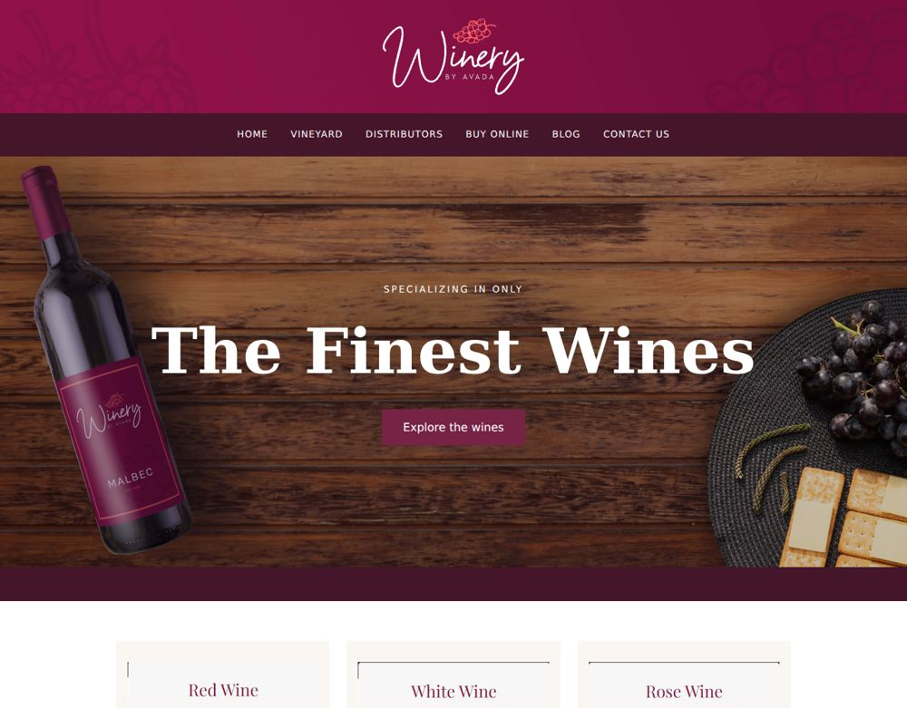

# Avada-inspired winery layout



A static winery storefront layout study built with HTML and CSS. Includes product imagery, article sections, local icon fonts and responsive styling.

## Run locally

Requires Python 3 for the optional static server. From this repository folder:

```bash
python -m http.server 8000
```

Open http://localhost:8000. No deployment is required.

## Repository structure

- `index.html` — page markup
- `css/main.css` — styles
- `script.js` — local subscription-form feedback
- `images/` — product and page imagery
- `fusion-icons/` — bundled icon fonts
- `docs/` — import provenance and review notes

## Scope and dependencies

Navigation links move to the corresponding page sections; subscription forms validate locally and explicitly state that no mailing service is connected; there is no cart, checkout or server. Google Fonts and Font Awesome require internet access. Avada branding and bundled artwork remain subject to their respective owners’ rights.

## Validation

Local HTML/CSS asset references and JavaScript syntax are checked during the import. See `docs/VALIDATION.md` for the actual results and limits. CI is defined in `.github/workflows/quality.yml`.

## Source preservation

All original project files were imported in a separate Git commit before changes. `docs/ORIGINAL_FILES.sha256` lists the archive file checksums. Existing images, fonts and notices are retained. No repository-wide license grant has been added.
